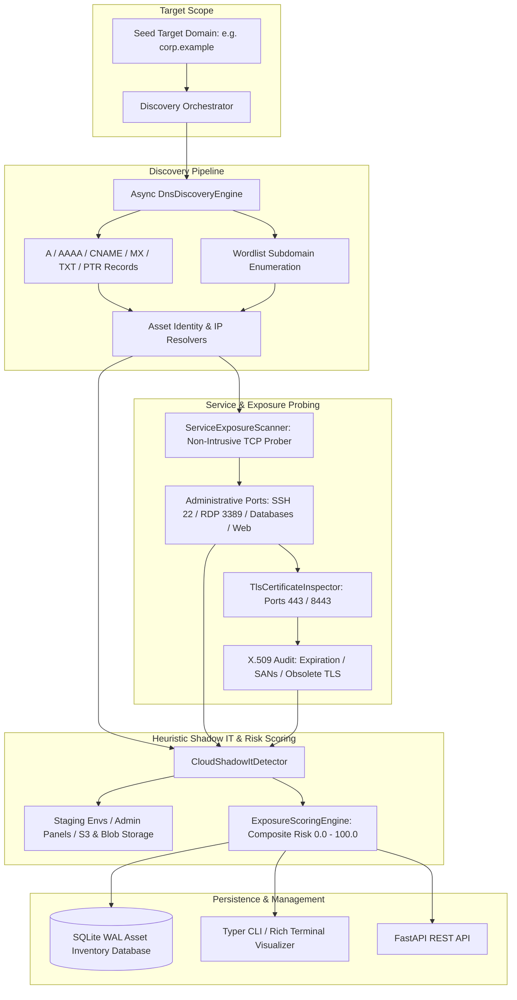

# Security Asset Discovery Platform (`asset-discovery`)

External Attack Surface Management (EASM), Asynchronous Multi-Source DNS Discovery, Wordlist Subdomain Enumeration, Port & Service Exposure Probing, X.509 TLS Certificate Inspection, and Shadow IT Heuristic Detection.

[](https://github.com/Krish9800/security-asset-discovery-platform/actions)
[](https://opensource.org/licenses/MIT)
[](https://www.python.org/)
[](https://mypy-lang.org/)
[](https://www.cisa.gov/)

---

## Overview & Problem Statement

Modern enterprise perimeters are dynamic and decentralized. With continuous cloud adoption, microservices, and remote infrastructure, organizations frequently lose track of forgotten development servers, exposed administrative interfaces, staging environments, unencrypted services, and public cloud storage buckets. Attackers continuously scan external IP ranges and DNS namespaces to identify these unmonitored assets as entry points.

**Security Asset Discovery Platform (`asset-discovery`)** is an External Attack Surface Management (EASM) engine designed to uncover and evaluate exposed internet-facing assets. It performs asynchronous DNS enumeration (A, AAAA, CNAME, MX, TXT, PTR), wordlist subdomain discovery, targeted non-intrusive service probing, deep X.509 SSL/TLS certificate auditing, and shadow IT heuristic detection, compiling all findings into an ACID-compliant asset inventory graph with composite exposure risk scores.

---

## Architecture & Data Flow



---

## Verified Features & Capabilities

- **Asynchronous DNS Discovery Engine**:
  - Resolves standard DNS records (`A`, `AAAA`, `CNAME`, `MX`, `TXT`) and performs reverse DNS (`PTR`) lookups asynchronously.
  - Implements wildcard DNS detection to prevent false-positive subdomain enumeration storms.
- **Wordlist Subdomain Enumeration**:
  - High-speed concurrent wordlist probing identifying subdomains, development endpoints, and auxiliary services.
- **Non-Intrusive Service Exposure Probing**:
  - Targeted asynchronous TCP socket probing for common administrative interfaces (SSH 22, RDP 3389), databases (MySQL 3306, PostgreSQL 5432, Redis 6379, MongoDB 27017), and web servers.
- **Deep X.509 SSL/TLS Inspection**:
  - Connects to secure endpoints (443, 8443) and extracts certificate metadata, Subject Alternative Names (SANs), issuer authority, expiration timelines, and deprecated protocol versions (TLS 1.0/1.1).
- **Cloud & Shadow IT Heuristic Detection**:
  - Detects staging/dev subdomains, exposed admin consoles, and public cloud storage patterns (AWS S3, Azure Blob, Google Cloud Storage).
- **Composite Risk Scoring Engine**:
  - Generates multi-factor Exposure Risk Scores (0.0 to 100.0) reflecting the severity of open management interfaces, database exposure, and certificate flaws.
- **Dual Interface**:
  - Command-line tool (`asset-discovery`) with interactive Rich tables for assets, findings, and scan reports.
  - Asynchronous FastAPI control plane for initiating scans and querying inventory.

---

## Technology Stack

- **Core Engine & CLI**: Python 3.12+, Typer, Rich, Pydantic v2
- **Network & DNS**: `asyncio`, `dnspython`, `ssl`, `socket`
- **Control Plane**: FastAPI, Uvicorn, Starlette
- **Persistence**: SQLite (Write-Ahead Logging mode)
- **Quality & Assurance**: Pytest, Pytest-Asyncio, Ruff, Mypy (strict typing)
- **Containerization**: Rootless multi-stage Docker (`UID 10001`)

---

## CLI Reference & Operational Usage

The platform provides the `asset-discovery` CLI:

```bash
# 1. Run an external attack surface discovery scan against a target domain
asset-discovery scan corp.example

# 2. Run a discovery scan using a custom SQLite database path
asset-discovery scan test.internal --db data/inventory.db

# 3. List discovered infrastructure assets
asset-discovery assets

# 4. Filter discovered assets by minimum risk score
asset-discovery assets --min-risk 50.0

# 5. List security exposures and shadow IT findings
asset-discovery exposures

# 6. Filter security exposures by severity
asset-discovery exposures --severity CRITICAL

# 7. Display detailed scan report by Scan ID
asset-discovery report "<scan-uuid>"
```

---

## REST API Control Plane

Start the FastAPI daemon:

```bash
uvicorn asset_discovery.api.app:app --host 127.0.0.1 --port 8000
```

Interactive OpenAPI documentation is available at `http://127.0.0.1:8000/docs`.

### Primary Endpoints

| Method | Endpoint | Description |
|:-------|:---------|:------------|
| `GET` | `/health` | Health telemetry and database connectivity status |
| `POST` | `/api/v1/scans` | Launch an asynchronous discovery scan against a target domain |
| `GET` | `/api/v1/assets` | Query discovered assets with pagination and risk filtering |
| `GET` | `/api/v1/assets/{asset_id}` | Retrieve detailed asset record with associated services and DNS records |
| `GET` | `/api/v1/exposures` | Query security exposures and shadow IT findings |

---

## Installation & Setup

```bash
# Clone the repository
git clone https://github.com/Krish9800/security-asset-discovery-platform.git
cd security-asset-discovery-platform

# Create and activate virtual environment
python3 -m venv .venv
source .venv/bin/activate

# Install dependencies in development mode
pip install --upgrade pip
pip install -e ".[dev]"
```

---

## Testing & Quality Assurance

Run the test suite:

```bash
# Run pytest test suite
pytest

# Run tests with code coverage metrics
pytest --cov=asset_discovery --cov-report=term-missing

# Run code style and lint checks
ruff check .
ruff format --check .

# Run static type verification
mypy src/asset_discovery
```

---

## Security Model & Threat Boundaries

A formal STRIDE threat model is documented in `docs/threat_model.md`:

- **Non-Exploitative Probing**: Network interactions are strictly limited to non-intrusive TCP handshakes and banner grabbing. The tool does not perform brute force authentication, denial-of-service, or vulnerability weaponization.
- **DNS Rate-Limiting & Timeout Safeguards**: DNS queries incorporate configurable timeout controls to prevent overwhelming external nameservers.
- **Least Privilege Runtime**: Docker containers execute as unprivileged user `UID 10001` with all Linux capabilities dropped (`cap_drop: ALL`).

---

## Limitations & Known Issues

- **Firewall & Rate-Limiting Drops**: Aggressive perimeter firewalls (WAFs or stateful drop rules) may throttle rapid port probes, resulting in filtered port classifications.
- **Subdomain Wordlist Coverage**: Wordlist discovery is bounded by the supplied wordlist; brute-force permutation scanning is omitted by design to avoid noisy network floods.

---

## License & Responsible Use

Distributed under the **MIT License** - see [LICENSE](https://opensource.org/licenses/MIT).

> [!CAUTION]
> **Authorization Notice:** Perform attack surface discovery and port probing only on domains, IP ranges, and infrastructure that you own or have explicit written authorization to assess.
